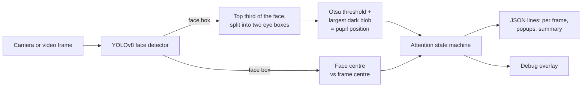

# Attention Tracker

[](https://github.com/Tarmk/FaceDetect/actions/workflows/ci.yml)

[](LICENSE)

Watches a webcam or a video file and estimates, frame by frame, whether the person in front of it is paying attention to the screen. It finds the face with a YOLOv8 face model, finds the pupils with plain OpenCV, and turns that into a state (`ATTENTIVE`, `LEFT`, `RIGHT`, `AWAY`), a 0–100 score, timers, and a "popup" event when someone has been distracted for too long. Everything is written as JSON lines, so another program can consume it.

Everything runs locally. No frames are saved or sent anywhere.

## How it works



The state machine ([`attention/state.py`](attention/state.py)) applies these rules every frame:

| State | When |
|---|---|
| `ATTENTIVE` | Both pupils found for 3+ frames in a row, face roughly centred and not turned (box not too narrow), both pupils within the on-screen band and near the middle of their eye box, and the eyes have moved in the last 2 s (a frozen stare does not count). |
| `LEFT` / `RIGHT` | Not attentive, and the face centre is more than 15% of the frame width left or right of centre. |
| `AWAY` | Anything else: no face for more than 400 ms, pupils outside the band, head pitched away (face box suddenly shrinks or touches the top edge). |

A new state has to appear on two frames in a row before it replaces the old one, except a lost face, which switches to `AWAY` at once after the grace period. Positions are smoothed with an exponential moving average. The score is 60 for a face, +25 if the gaze is on screen, +15 if the state is `ATTENTIVE`.

After 3 s of continuous distraction a popup event is printed, at most once every 10 s. All of these numbers are command-line flags.

## Install

Python 3.9 or newer.

```bash
git clone https://github.com/Tarmk/FaceDetect.git
cd FaceDetect
python -m venv .venv
source .venv/bin/activate        # Windows: .venv\Scripts\activate
pip install -r requirements.txt  # ultralytics (PyTorch), OpenCV, NumPy, requests
```

On the first run the face weights (`yolov8n-face-lindevs.pt`, from [lindevs/yolov8-face](https://github.com/lindevs/yolov8-face)) are downloaded into `weights/`. Pass `--model path/to/weights.pt` to use another face-capable YOLO checkpoint.

## Use

```bash
python attn_tracker.py                              # webcam 0 with the debug window
python attn_tracker.py --src lecture.mp4 --no-overlay --quiet
python attn_tracker.py --src 1 --start 5 --end 120 --jsonl frames.jsonl
```

With a video file, `--start`, `--end` and every timer use the video's own clock, so results do not depend on how fast your computer processes it.

In the debug window: **S** starts a session, **E** ends it and prints the share of time that was not attentive, **P** or Space pauses, **Q** or Esc quits.

### Output

One JSON object per line on stdout (per-frame lines go to `--jsonl FILE` instead, if given):

```json
{"t": 12.47, "face_present": true, "bbox": [262, 131, 118, 152], "gaze_to_screen": true, "center_offset": -0.0213, "state": "ATTENTIVE", "attention_score": 100, "lpupil_px": [291, 165], "rpupil_px": [349, 166], "eye_speed_l_pxps": 21.4, "eye_speed_r_pxps": 19.8, "pupil_still_time_s": 0.0}
{"type": "popup", "message": "Stop being distracted.", "state": "AWAY", "at_seconds": 31.2}
{"type": "summary", "duration_s": 120.0, "frames": 3598, "attentive_time_s": 84.3, "distracted_time_s": 35.7, "attention_percent": 70.25, "distracted_breakdown": {"LEFT": 6.1, "RIGHT": 2.4, "AWAY": 27.2}, "popups_triggered": 3}
```

(The values above show the format; they are not from a real recording.)

### Main flags

| Flag | Default | Meaning |
|---|---|---|
| `--src` | `0` | Camera index or video path |
| `--overlay` / `--no-overlay` | on | Debug window |
| `--quiet`, `--jsonl FILE` | | Suppress or redirect per-frame lines |
| `--start`, `--end` | 0, ∞ | Time window in seconds |
| `--px-left`, `--px-right` | 0.35, 0.65 | Pupil x band that counts as "on screen" |
| `--center-distract` | 0.15 | Face offset that counts as turned left/right |
| `--face-miss-ms` | 400 | Grace period before a missing face means `AWAY` |
| `--popup-after-s`, `--popup-cooldown-s` | 3, 10 | Popup timing |
| `--min-face-conf`, `--adaptive-conf` | 0.3, on | Face threshold; lowered after 10 frames without a face |
| `--device`, `--imgsz` | auto, 640 | YOLO device (`cpu`, `0`, `mps`) and input size |

`python attn_tracker.py --help` lists the rest.

## Limitations

- The pupil finder is a heuristic: it looks for the largest dark blob in the eye box, so glasses glare, heavy eye make-up, very dark lighting or long fringes can confuse it.
- Head pose is approximated from the face box (position and aspect ratio), not estimated in 3D. Facial landmarks with `solvePnP` would be the next step for real head pose and gaze.
- "Looking at the screen" assumes the camera sits at the screen.

## Project layout

```
attn_tracker.py      command-line entry point: capture loop, keys, JSON output
attention/
  config.py          thresholds
  detector.py        YOLO face detector and weight download
  vision.py          eye boxes and the pupil finder
  state.py           state machine, timers, popups, sessions, summary
  overlay.py         debug drawing
tests/               pytest (no YOLO needed)
```

## Development

```bash
pip install -r requirements-dev.txt
pytest
ruff check . && ruff format --check .
```

The state machine is fed plain numbers in the tests (face boxes and pupil positions with timestamps), so its rules are checked without a camera or the model.

## License

MIT for the code in this repository, see [LICENSE](LICENSE). The dependencies keep their own licences: [Ultralytics](https://github.com/ultralytics/ultralytics) is AGPL-3.0, and the face weights come from [lindevs/yolov8-face](https://github.com/lindevs/yolov8-face). Check both before redistributing a build.
